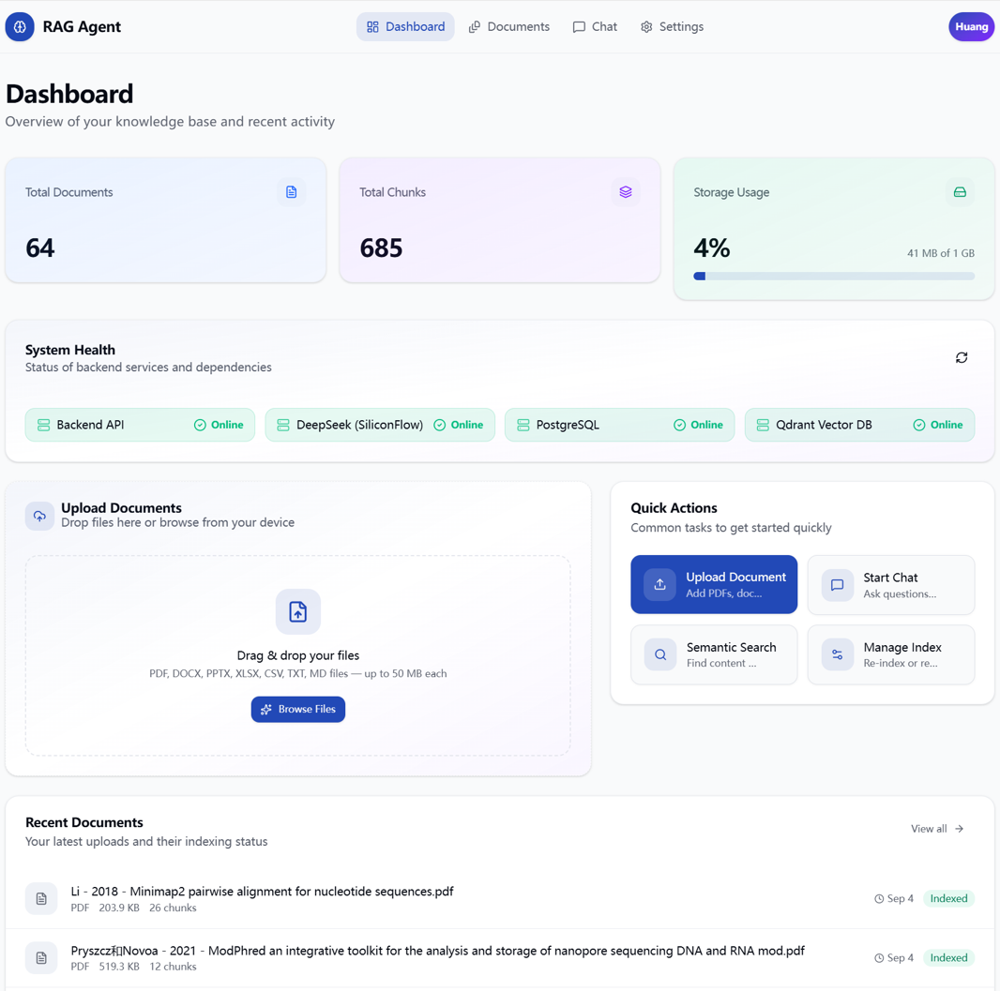
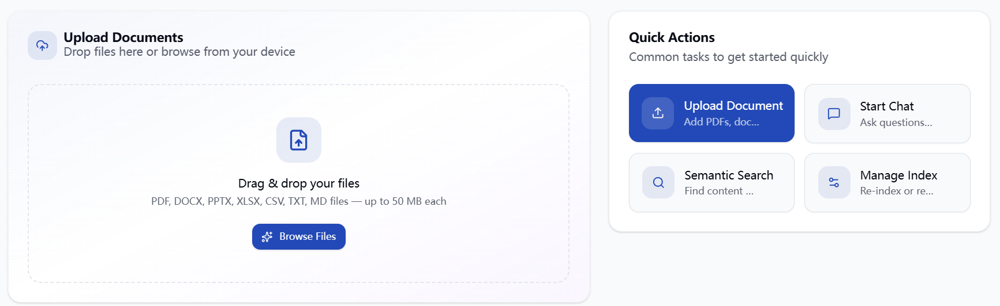
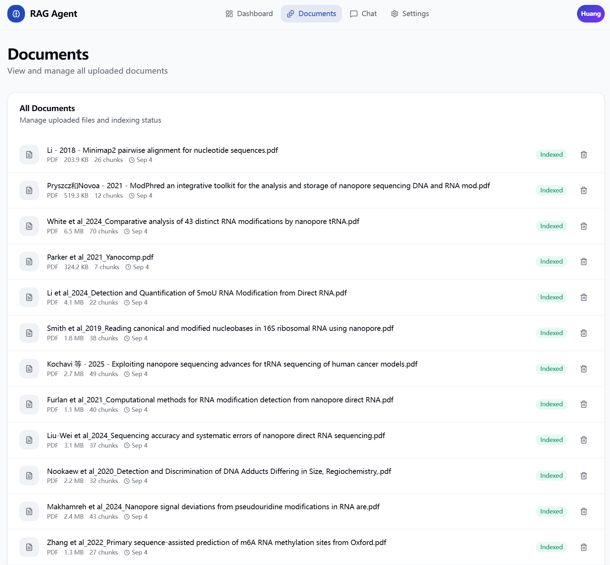
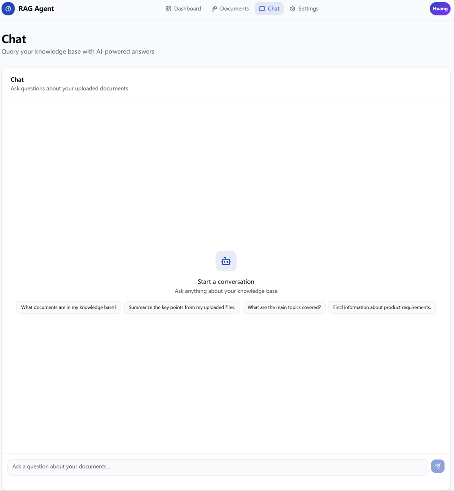

# 🚀 Production RAG Agent

### 面向文档知识问答的检索增强生成平台

基于 LangGraph、FastAPI 与 Next.js 构建的全栈 RAG
应用，支持文档导入、文本切分、向量索引、语义检索和带来源依据的 AI
问答。模型服务通过环境变量配置，当前使用 **DeepSeek-V3**
作为大语言模型、**BGE-M3** 作为文本向量模型。


---

## 项目简介

Production RAG Agent
是一个围绕私有文档构建知识问答能力的全栈应用。系统会先处理用户上传的文件，将文档内容转换为可检索的文本片段并生成向量；用户提问后，检索模块从知识库中找出相关内容，再由大语言模型结合检索结果组织回答，并返回对应的来源信息。

与直接将问题交给模型回答的方式相比，这种流程可以让生成结果参考用户提供的资料，便于追溯回答依据。项目同时关注实际运行中的稳定性，包括分块标识、重复文件识别、批量向量化、异常重试、索引续接和服务状态检查等环节。

## 功能概览

- **文档入库**：上传常见办公文档和文本文件，完成解析、切分、向量化及索引。
- **语义检索**：使用向量检索查找与问题相关的文本片段。
- **RAG 问答**：通过 LangGraph
  编排检索与生成流程，返回结合资料内容的回答。
- **来源追踪**：在回答中提供相关文档来源，帮助用户核对信息。
- **流式交互**：支持逐步接收模型输出，并在前端渲染 Markdown 和代码块。
- **文档管理**：查看已入库文件、文档元信息和切分统计，并支持删除操作。
- **运行状态面板**：展示后端、数据库、向量库以及文档和片段数量等信息。
- **容器化运行**：通过 Docker Compose 管理后端服务及其运行依赖。

---

## 主要功能

### 1. 文档解析与索引

目前 README 中列出的支持格式包括：

- PDF
- DOCX
- PPTX
- XLSX
- CSV
- TXT
- Markdown

文档上传后进入统一处理流程：检查文件、提取文本、划分片段、调用向量模型生成
embedding，最后将相关数据写入存储层并建立检索索引。实际可解析范围仍取决于项目当前的解析器实现及文件本身的内容结构。

### 2. 文本切分策略

系统采用可配置的分块流程，将较长的文档拆分为适合检索和模型处理的文本单元。相关设计包括：

- 递归式文本切分；
- 可调整的片段长度；
- 相邻片段之间保留一定重叠；
- 为片段生成稳定标识；
- 识别重复文档，减少重复处理；
- 在索引流程中断后尽可能续接处理。

稳定的片段标识有助于降低重复写入的风险；分块重叠则用于保留跨越片段边界的上下文。

### 3. 检索增强生成流程

一次典型问答请求按以下步骤执行：

1. 用户在聊天界面提交问题。
2. 系统将问题转换为向量表示。
3. Qdrant 根据向量相似度召回相关文档片段。
4. LangGraph 组织检索结果和问题上下文。
5. DeepSeek-V3 根据提供的上下文生成回答。
6. 前端接收生成内容，并展示可供核对的来源信息。

检索结果为生成模型提供外部资料依据，但并不意味着回答必然正确；对重要结论仍应检查引用片段是否真正支持对应表述。

### 4. 向量化任务的稳定性设计

针对外部模型服务可能出现的限流、超时或批量请求失败，项目包含以下处理思路：

- 根据任务情况调整批次大小；
- 失败后进行重试；
- 采用指数退避，并在重试间加入随机抖动；
- 必要时缩小批次，降低单次请求压力；
- 控制并发请求数量；
- 避免对已完成内容重复处理。

具体吞吐量和处理时长会受到文件规模、模型服务配额、网络状态及部署资源影响。

### 5. 对话界面

聊天模块提供面向知识问答的交互能力：

- 连续对话；
- 流式输出；
- Markdown 内容展示；
- 代码块格式化；
- 复制回答；
- 展示回答关联的来源。

### 6. 文档管理

用户可以在文档管理页面查看知识库中的文件，并使用以下能力：

- 上传和删除文档；
- 查看重复文件或已完成索引的提示；
- 浏览文档元信息；
- 查看文档切分后的片段统计。

### 7. 服务状态与数据概览

仪表盘用于集中查看应用运行情况和知识库规模，页面涉及的项目包括：

- 后端 API 状态；
- 大语言模型服务状态；
- PostgreSQL 状态；
- Qdrant 状态；
- 文档数量；
- 文本片段数量；
- 存储使用情况。

页面展示内容以当前代码实现为准；服务状态检查不等同于对模型回答质量的评估。

---

## 系统架构

```text
┌──────────────────────┐
│     Next.js 前端     │
│ 文档管理 / 聊天 / 面板 │
└──────────┬───────────┘
           │ REST API / 流式响应
           ▼
┌──────────────────────┐
│     FastAPI 后端     │
│ 上传处理 / 检索 / 问答 │
└──────────┬───────────┘
           │
           ▼
┌──────────────────────┐
│   LangGraph 工作流   │
│ 检索编排与回答生成    │
└──────┬────────┬──────┘
       │        │
       ▼        ▼
┌────────────┐ ┌────────────┐
│ DeepSeek-V3│ │   Qdrant   │
│ 回答生成   │ │ 向量检索库 │
└────────────┘ └─────┬──────┘
                     │
               BGE-M3 向量化

       PostgreSQL：持久化存储元数据等业务数据
```

## 技术选型

---

  层级                    技术                                   用途

---

  前端                    Next.js、React、TypeScript、Tailwind   页面构建与交互
                          CSS

  后端                    Python、FastAPI                        API 服务及业务处理

  工作流                  LangGraph                              编排检索与生成步骤

  大语言模型              `deepseek-ai/DeepSeek-V3`              根据问题和检索上下文生成回答

  Embedding 模型          `BAAI/bge-m3`                          将文本转换为向量表示

  关系型数据库            PostgreSQL                             保存应用所需的结构化数据

  向量数据库              Qdrant                                 存储向量并执行相似度检索

部署                    Docker、Docker Compose                 管理容器化服务
-----------------------------------------------------------------------------

---

## 应用界面

### 运行状态面板



### 上传文档



### 文档列表



### AI 问答



---

## 快速开始

### 1. 获取项目代码

```bash
git clone https://github.com/rounakkumarsah/Production-RAG-Agent.git
cd Production-RAG-Agent
```

### 2. 配置环境变量

根据项目中的示例文件创建根目录和后端所需的环境配置：

```text
.env.example
backend/.env.example
```

复制为对应的 `.env` 文件后，按实际部署环境填写数据库连接、Qdrant
地址及模型服务配置。当前模型配置为：

```dotenv
LLM_MODEL=deepseek-ai/DeepSeek-V3
EMBEDDING_MODEL=BAAI/bge-m3
```

请同时确认项目实际使用的模型服务提供方、API Key
对应的环境变量名称、服务地址以及模型标识格式，并按代码要求补齐。不要将真实密钥提交到公开仓库。

### 3. 启动后端

```bash
cd backend
docker compose up --build
```

该命令会依据 `backend/docker-compose.yml`
中的定义构建并启动服务。首次启动时可能需要下载镜像和安装依赖，耗时取决于网络与机器配置。

### 4. 启动前端

在另一个终端窗口中进入项目根目录并执行：

```bash
npm install
npm run dev
```

### 5. 访问服务

  服务               本地地址

---

  Web 前端           http://localhost:3000 
  后端 API           http://localhost:8000 
  Swagger 接口文档   http://localhost:8000/docs

若实际端口在环境配置或 Docker Compose 文件中发生变化，请以对应配置为准。

---

## 目录结构

```text
Production-RAG-Agent/
├── app/                       # 前端应用页面
├── backend/
│   ├── app/                   # 后端应用入口及核心逻辑
│   ├── services/              # 业务服务
│   ├── api/                   # API 路由
│   ├── docker-compose.yml     # 后端容器编排
│   └── requirements.txt       # Python 依赖
├── components/                # 前端组件
├── lib/                       # 前端公共逻辑
├── public/                    # 静态资源
├── screenshots/               # README 界面截图
├── package.json
├── next.config.ts
└── README.md
```

目录说明根据 README 中的项目结构整理，具体职责请以代码文件为准。

---

## 工程实现要点

项目重点覆盖了 RAG 应用从文档进入系统到最终回答呈现的关键环节：

- **稳定的分块标识**：为文本片段生成可重复使用的 ID。
- **重复内容识别**：尽量避免相同文档被反复索引。
- **索引任务续接**：支持对中断后的处理流程进行恢复。
- **批量向量化控制**：根据请求情况调整批处理策略。
- **异常重试机制**：通过退避与抖动降低短时故障带来的影响。
- **相似度阈值筛选**：过滤不满足检索条件的候选内容。
- **流式生成**：逐步向前端传递模型输出。
- **健康状态检查**：检查关键服务的运行情况。
- **容器化部署**：使用 Docker 相关配置简化环境启动。

以上为 README
所描述的设计能力；其覆盖范围和实际效果应结合当前分支代码、配置文件及运行测试确认。

---

## 后续可扩展方向

以下为可继续迭代的功能规划，不代表已经实现：

- [ ] 将文档处理迁移到独立后台任务；
- [ ] 增加异步上传与任务队列；
- [ ] 引入 Redis 缓存；
- [ ] 增加用户认证；
- [ ] 支持多租户知识库；
- [ ] 实现基于角色的访问控制；
- [ ] 完善可观测性与运行指标面板；
- [ ] 探索 Kubernetes 部署；
- [ ] 建立 CI/CD 流水线；
- [ ] 增加自动化检索与回答评估。

---

## 项目涉及的实践内容

通过该项目可以实践以下技术主题：

- 检索增强生成（RAG）的基本流程；
- 文档解析、文本切分与向量索引；
- 向量数据库和语义检索；
- LangGraph 工作流组织；
- DeepSeek-V3 模型调用；
- BGE-M3 文本向量化；
- FastAPI 服务开发；
- Next.js 全栈应用开发；
- PostgreSQL 与 Qdrant 的协同使用；
- Docker 容器化部署与服务检查。
